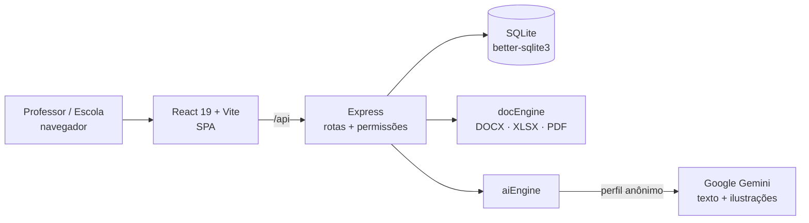

# ApoIA.Edu — IA para a Educação Inclusiva

**Do planejamento à atividade em sala: um histórico pedagógico que acompanha o estudante da Educação Especial.**

O ApoIA.Edu ajuda professores e escolas a elaborar o Estudo de Caso, o PAEE e o PEI, gerar atividades acessíveis em A4 e registrar o que aconteceu em sala, tudo ligado ao perfil de cada estudante. A IA sugere; o educador revisa e decide.

🔗 **Demo:** https://apoia-edu.vercel.app/ (sem cadastro, só dados fictícios)
🎬 **Vídeo:** ⚠️ [PREENCHER: link do YouTube]
🏁 **Hack Brasil 2026:** trilha *Acesso à educação* · time LumiNextTech

---

## ⚡ Teste em 2 minutos

1. Abra a [demo](https://apoia-edu.vercel.app/) e clique em **Experimentar demonstração → Entrar como Perfil Professor(a)**.
2. Escolha **Sofia R.** e veja o **perfil pedagógico**: potencialidades, interesses, comunicação e estratégias que funcionam, sem exigir laudo.
3. Clique em **Gerar atividade a partir deste objetivo**, preencha um tema (ex.: *Contagem de 1 a 5 com animais*) e clique em **Gerar atividade / plano de aula**.
4. Veja a folha A4 adaptada (CAIXA ALTA, poucos estímulos por página) e exporte em **DOCX** ou **JPEG**.
5. Clique em **Registrar como foi** e confira a **linha do tempo** de evidências do estudante.

> Quer explorar tudo (documentos da escola, transferência entre escolas, perfil Escola)? Veja o [guia completo da demonstração](docs/GUIA_DEMONSTRACAO.md) (15–20 min).

---

## O problema

A educação especial teve **2,5 milhões de matrículas em 2025, 82% a mais do que em 2021** (Censo Escolar 2025/Inep). A maioria desses estudantes está em classes comuns, e cada um precisa de documentos e atividades individualizados.

Imagine uma professora com dez turmas e três estudantes da Educação Especial em cada uma: são 30 estudantes com potencialidades, interesses e barreiras diferentes. Hoje ela enfrenta:

- **Fragmentação:** documentos, atividades e registros espalhados em papel, planilhas e pastas.
- **Planejamento desconectado da prática:** os objetivos do PEI e os apoios do PAEE nem sempre chegam à atividade em sala.
- **Personalização só pelo diagnóstico:** atividades pensadas pelo laudo, não pelo estudante.
- **Retrabalho documental:** as mesmas informações copiadas em vários modelos.
- **Descontinuidade:** quando o estudante muda de escola, o histórico pedagógico se perde e tudo recomeça.

## A solução

Um fluxo único, centrado no estudante:

**Perfil → Estudo de Caso → PAEE → PEI → atividades e planos de aula → registros de aplicação → revisão**

| Diferencial | Como funciona no ApoIA | Valor para a escola |
| --- | --- | --- |
| Planejamento conectado à prática | A atividade usa o objetivo do PEI e os apoios do PAEE | O que foi planejado chega à sala de aula |
| Personalização além do diagnóstico | Perfil com potencialidades, interesses, comunicação, barreiras e estratégias | Atividades pensadas para o estudante, não para o laudo |
| Acompanhamento com evidências | Registro de participação, alcance do objetivo, nível de apoio e próximo passo | Revisões bimestrais baseadas no que aconteceu |
| Modelos da própria escola | Importa DOCX, XLSX e PDF e preenche cópias dos modelos institucionais | Menos transcrição manual |
| Continuidade entre escolas | Código de transferência com aprovação; documentos e registros seguem o estudante | O histórico não recomeça a cada mudança |
| Revisão humana obrigatória | Minutas com fontes identificadas, pendências e versões | A equipe valida tudo o que a IA sugere |
| Colaboração com permissões | Perfis Escola e Professor, vínculos e revogação imediata de acesso | Cada profissional vê só o que deve |

## 🏫 De onde viemos: a demanda já é validada

O ApoIA.Edu não começou do zero. A primeira versão do APOIA é um **agente de IA configurado no Microsoft Copilot** ([documentação](https://github.com/ElizabethCOliveira/ApoIA)), que já é usado por professoras para adaptar atividades.

⚠️ [PREENCHER com dados reais e autorizados. Apenas números agregados, nenhum dado de estudante.]

- Agente em uso desde ⚠️ [mês/ano] em ⚠️ [N] escolas de ⚠️ [cidade/UF].
- ⚠️ [N] professoras usando · ⚠️ [N] atividades adaptadas geradas.
- Depoimento: "⚠️ [frase da professora]" — ⚠️ [nome, função, escola, com autorização].

**O que aprendemos com esse uso** e levamos para o ApoIA.Edu: ⚠️ [PREENCHER com 2 ou 3 aprendizados reais, por exemplo "as professoras precisavam guardar o histórico de cada estudante", "a escola exige os próprios modelos de PEI e PAEE", "o agente não lembrava do estudante entre uma conversa e outra"].

O agente gera atividades soltas. O **ApoIA.Edu**, criado durante o Hack Brasil, transforma isso numa plataforma: histórico por estudante, documentos oficiais nos modelos da escola, permissões por escola e professor, e registro do que aconteceu em sala.

> A demo pública é **isolada e usa só dados fictícios**. Nenhum dado das escolas é usado aqui.

---

## Arquitetura



- **Frontend:** React 19, TypeScript, Vite, Tailwind CSS. Exportação A4 em JPEG via canvas (`src/utils/a4CanvasExport.ts`).
- **Backend:** Node.js 24 + Express. Autenticação por sessão em cookie `httpOnly`, senhas com `scrypt` e comparação em tempo constante.
- **Banco:** SQLite com tabelas de escolas (`workspaces`), vínculos professor–estudante, documentos, atividades, registros de aplicação, transferências e log de auditoria administrativa.
- **Documentos:** `docx`, `exceljs`, `mammoth`, `unpdf` e manipulação direta do XML do DOCX para preencher os modelos da escola mantendo tabelas e mesclagens.
- **IA:** `@google/genai`, chamado **somente no servidor**, com modelo principal e modelo reserva configuráveis, novas tentativas em erros temporários e geração de ilustrações didáticas sem texto.

### Decisões de projeto

- **A chave da IA nunca vai para o navegador.** Toda chamada ao Gemini passa pelo servidor.
- **A IA recebe um resumo anônimo do perfil** (`buildAnonymizedStudentBrief`): código ou iniciais do estudante, ano/série, potencialidades, interesses, barreiras e estratégias. Nunca o nome completo. ⚠️ [CONFIRMAR e citar onde fica no código: "o envio de dados reais à IA vem desligado por padrão até a escola autorizar".]
- **Permissões checadas no servidor** em cada rota e no download de anexos. Ao encerrar um vínculo, o acesso é bloqueado na hora.
- **Demo pública isolada:** na Vercel (`api/index.ts`), só as rotas `/api/demo/*` ficam abertas. Contas reais ficam bloqueadas e a geração por IA tem limite por visitante e por hora.
- **SQLite:** simples para o protótipo. Na Vercel o banco fica em `/tmp` e é **temporário**, o que é intencional para a demo. ⚠️ [PREENCHER: onde roda a versão das escolas e como é feito o backup, ou "em produção, a migração prevista é para PostgreSQL gerenciado".]

## Como executar localmente

**Pré-requisitos:** Node.js 24.x e npm. O `better-sqlite3` compila um módulo nativo; no Linux pode exigir `build-essential` e Python 3.

```bash
git clone https://github.com/ElizabethCOliveira/apoia-edu.git
cd apoia-edu
npm install
cp .env.example .env      # e preencha GEMINI_API_KEY
npm run dev               # http://localhost:3000
```

| Variável | Obrigatória | Para que serve |
| --- | --- | --- |
| `GEMINI_API_KEY` | Para usar a IA | Chave da API Gemini ([Google AI Studio](https://aistudio.google.com/)). Sem ela, a demo funciona com os exemplos prontos. |
| `GEMINI_MODEL` / `GEMINI_FALLBACK_MODEL` | Não | Troca o modelo principal e o reserva sem mexer no código |
| `APP_URL` | Não | URL pública usada nos links de convite e de recuperação de senha |
| `STORAGE_ROOT` | Não | Pasta do banco e dos anexos (padrão: `./storage`) |
| `LUMINEXT_ADMIN_EMAIL` / `_PASSWORD` / `_NAME` | Não | Cria o primeiro administrador. Também pode usar `npm run admin:init` |

Outros comandos:

```bash
npm run lint     # checagem de tipos (tsc --noEmit)
npm run build    # build do frontend em dist/
npm start        # servidor em modo produção
```

> A pasta `storage/` guarda o banco e os anexos e **nunca é servida publicamente**: todo arquivo passa por rotas autorizadas da API.

## Estrutura do código

| Caminho | Responsabilidade |
| --- | --- |
| `src/App.tsx`, `src/components/` | Interface e fluxos pedagógicos |
| `server/routes.ts` | API: estudantes, documentos, atividades, escolas, transferências, demo |
| `server/aiEngine.ts` | Prompts, chamadas ao Gemini, modelo reserva e ilustrações |
| `server/docEngine.ts` | Extração e preenchimento de DOCX/XLSX/PDF e exportação |
| `server/auth.ts`, `server/db.ts` | Sessões, senhas, permissões e esquema do banco |
| `server/demo.ts` | Cenários fictícios e sessões isoladas da demonstração |
| `server.ts` | Servidor completo (local / produção) |
| `api/index.ts` | Entrada da Vercel, restrita à demonstração |

## Histórico de desenvolvimento

- **⚠️ [mês/ano]:** Elizabeth cria o APOIA como agente no Microsoft Copilot (sem código próprio: configuração por instruções). O agente passa a ser usado em escolas.
- **09/11/2026:** documentação do agente publicada em [ElizabethCOliveira/ApoIA](https://github.com/ElizabethCOliveira/ApoIA).
- **23/11/2026:** durante o Hack Brasil, o time começa o **ApoIA.Edu**, uma plataforma nova escrita do zero com apoio de ferramentas de IA para geração de código (⚠️ [CONFIRMAR: Google AI Studio]), e publica o código neste repositório no mesmo dia.
- **24–30/11/2026:** melhorias do time (testes, CI, documentação e ajustes), registradas nos commits.

Nenhum código anterior ao evento foi copiado para este repositório. O agente do Copilot não tem código-fonte: ele é configurado na própria plataforma da Microsoft.

## Próximos passos

- Testes automatizados de permissões e de preenchimento de modelos, com CI no GitHub Actions.
- Rascunho da revisão bimestral do PEI a partir dos registros de aplicação.
- Banco gerenciado com backup para escalar para redes municipais.
- Auditoria de acessibilidade do próprio app (WCAG).

## Limites e responsabilidade

Protótipo funcional em validação. Os conteúdos gerados pela IA são **sugestões** e precisam ser revisados por profissionais da educação. O ApoIA **não faz diagnóstico** e não substitui a avaliação de profissionais. A preservação de formatação depende do modelo importado; não se promete compatibilidade com qualquer documento. Não divulgamos percentuais de economia de tempo ou resultados de aprendizagem que ainda não foram medidos.

## Time

Elizabeth da Conceição Oliveira · Nycollas Reydan Alves Peixoto · Jéssica Lima de Carvalho Pastor

## Licença

⚠️ [PREENCHER: recomendado incluir um arquivo `LICENSE`, por exemplo MIT. Sem licença, o júri ainda pode ler e testar o código, mas a escolha deixa claro como ele pode ser usado.]
